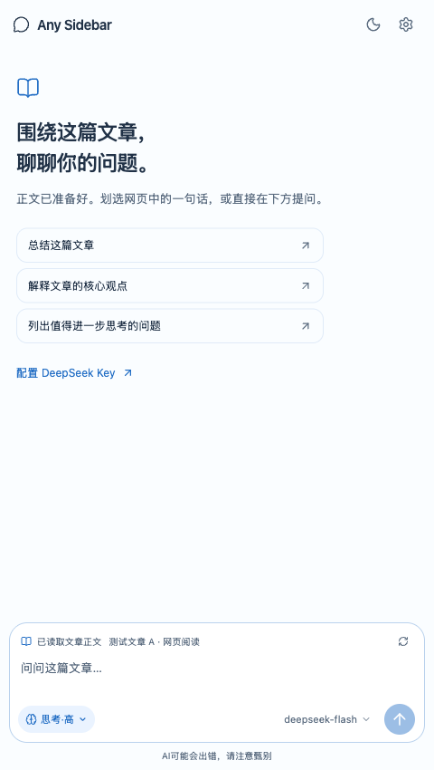

# Any Sidebar

在 Chrome 侧边栏里，围绕正在阅读的网页和 AI 对话。

打开侧栏后，Any Sidebar 会自动读取文章正文。划选一段文字，就可以直接问它是什么意思，或让它结合上下文解释代码。



## 能做什么

- **读网页**：自动提取已加载的正文，提问时一并提供给模型。
- **划选提问**：引用网页文字或 AI 的回答，继续追问；网页引用支持累积或仅保留最新一段。
- **按网页保存对话**：切换页面时切换会话，回到原页面可以继续聊。
- **选择模型和思考强度**：直接在输入框下方切换 DeepSeek 模型及思考选项。
- **舒服地阅读**：支持亮暗主题、字号调整、代码与表格，以及一键回到最新消息。

## 安装

目前还没有上架 Chrome 应用商店，可以先通过 GitHub 安装。需要桌面版 Chrome **142 或更高版本**。

1. 打开 [Releases](https://github.com/decous37/any-sidebar/releases)，下载最新版本的 `any-sidebar-*.zip` 并解压。
2. 在 Chrome 地址栏打开 `chrome://extensions`，开启右上角的「开发者模式」。
3. 点击「加载已解压的扩展程序」，选择解压后**包含 `manifest.json` 的文件夹**。
4. 点击浏览器工具栏中的 Any Sidebar 图标，打开设置，填写自己的 [DeepSeek API Key](https://platform.deepseek.com/)。

打开一篇文章，划选感兴趣的内容，然后在侧栏提问即可。使用和快捷键的详细说明见 [使用指南](docs/user-guide.md)。

> 插件免费，调用 DeepSeek API 的费用由你的 DeepSeek 账户承担。Any Sidebar 是独立项目，与 DeepSeek 和 Google 没有官方关联。

## 隐私与限制

文章正文在本机读取；只有发送问题、重试或重新生成时，相关正文、引用和对话才会发送给 DeepSeek。对话和 API Key 保存在本机浏览器，不会同步到项目方服务器；本机存储并不是加密保险箱。

扩展需要访问 HTTP/HTTPS 网页，才能自动读取当前文章。Chrome 内部页面、扩展商店和 PDF 等受浏览器或当前版本限制，无法按普通网页读取。正文提取效果也会因网站结构而异。

请不要将敏感网页内容或密钥发给不信任的服务。更多信息见[隐私说明](public/privacy.html)。

## 从源码运行

需要 Node.js 24.15+（24.x）或 26.x，以及 npm。项目根目录的 `.nvmrc` 提供了一个可用版本。

```bash
npm ci
npm run build
```

然后在 `chrome://extensions` 中加载项目的 `dist` 目录。代码修改后重新构建，并在扩展管理页点击「重新加载」。

常用检查：

```bash
npm run typecheck
npm run lint
npm test
npm run audit:package
npm run package
```

浏览器自动化测试还需要 `npx playwright install chromium`，然后运行 `npm run test:e2e`。测试使用模拟接口，不需要真实 API Key。阅读理解提示的真实模型对照仍待完成，详见[评测说明](docs/reading-evaluation.md)。

## 反馈与许可

遇到问题或有建议，欢迎在 [Issues](https://github.com/decous37/any-sidebar/issues) 中提出。请不要在 Issue 中粘贴 API Key 或私人网页内容。

项目采用 [MIT 许可证](LICENSE)；第三方组件的许可见 [THIRD_PARTY_NOTICES.txt](THIRD_PARTY_NOTICES.txt)。
